<!--
  PLANTILLA del README. No edites README.md a mano: se regenera con `npm run build`.
  Edita aquí el texto fijo; los marcadores {{...}} se rellenan desde skills.json.
-->

# {{TITULO}}

**TODO: una frase corta sobre ti (qué construyes, qué te apasiona).**

### 🚀 [Explorar el sistema solar en 3D →]({{SITE_URL}})

_Cada planeta es una categoría, cada luna una skill, cada estación espacial un proyecto._

## 🪐 Elige un planeta

{{FILA_PLANETAS}}

## 🌌 Skills por categoría

{{DETALLES}}

{{TELEMETRIA}}## 📝 Resumen en texto

{{LISTA_TEXTO}}

## 📫 Contacto

- 💼 LinkedIn: TODO
- ✉️ Correo: TODO
- 🌐 Web: [{{SITE_URL}}]({{SITE_URL}})

Este README se genera automáticamente desde [`skills.json`](skills.json). Para cambiar algo, edita ese archivo y haz push.
